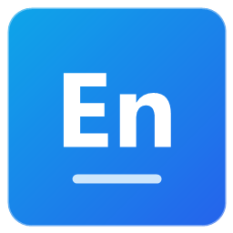
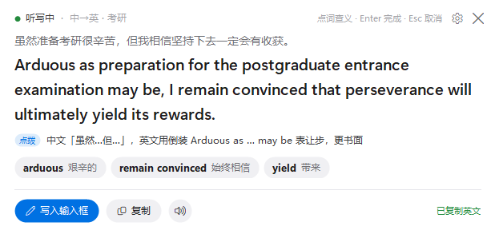
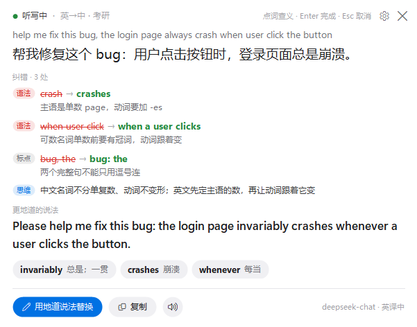
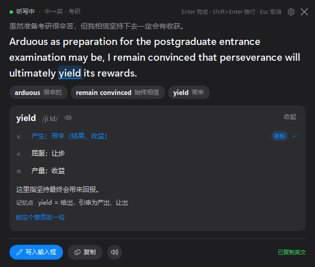
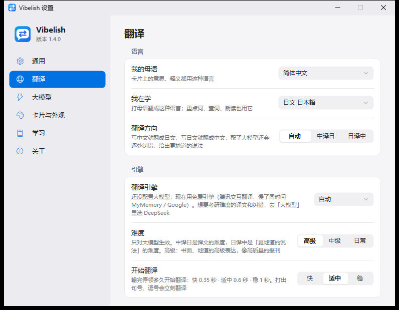
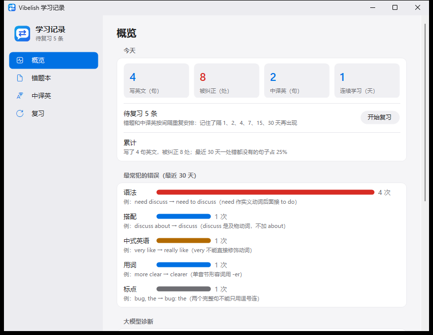
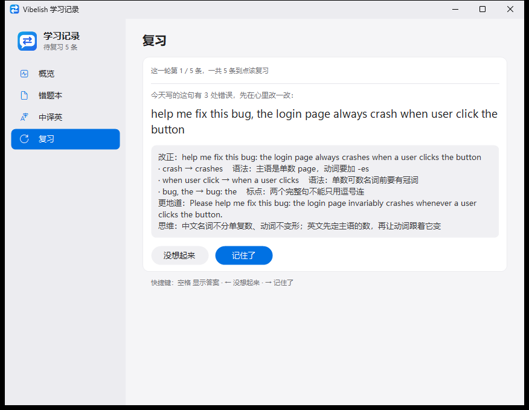
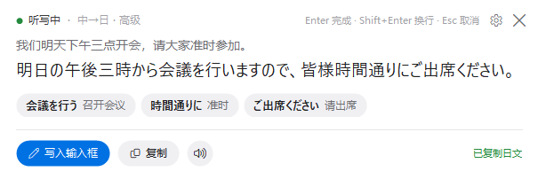
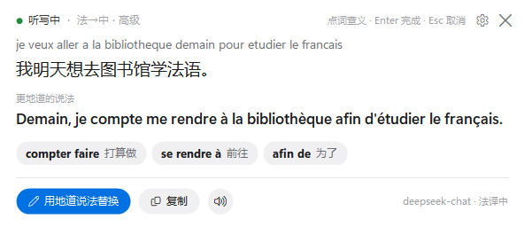

<div align="center">



# Vibelish

**写 prompt 的时候，顺手学外语。**

Windows 托盘小工具：在任意输入框里写中文，旁边的卡片实时给出考研难度的英文；<br>
直接写英文，卡片逐处纠错、讲清背后的中文思维，再给出更地道的说法。<br>
不只是中英：母语和在学的语言都能自己选，日文、韩文、法文、西班牙文……都行。


</div>

<p align="center">
  
  
</p>

## 为什么做它

Vibe coding 的时候，一天里大半时间都在跟 AI 打字对话。反正要打这么多字，不如顺手把英语也练了：

- **写中文**：照常把需求写进 Claude Code、Cursor、终端或者任何输入框，Vibelish 在旁边给出一句考研难度的英文，挑出几个值得记的词。觉得合适，按 **Ctrl+Shift+Enter** 把中文换成英文再发出去。
- **写英文**：想练英文写作，就直接用英文写 prompt。Vibelish 把你写的英文翻回中文，你一眼就能看出意思对不对；配了大模型，还会逐处指出语法、用词、搭配、中式英语的错误，说清为什么错、背后是什么中文思维，再给一句更地道的说法。
- **记下来、练回去**：写完的句子（回车发出去，或按 Esc 完成）自动记进学习记录。写错的进错题本，中译英的进练习本，按 1、2、4、7、15、30 天的间隔复习；写够几句还能让大模型诊断你最常犯的错和该怎么练。

不用切窗口，不用复制粘贴，不打断手上的活。

## 功能

- **中译英 / 英译中，自动判断**：输入里有中文就翻成英文，纯英文就翻成中文。也可以在托盘菜单或设置里固定一个方向。
- **多种语言**：母语和在学的语言可以从 14 种里任选（简体 / 繁体中文、英、日、韩、法、德、西、葡、意、俄、越、泰、印尼），比如中文学日文、日文学英文、英文学法文。见[多语言](#多语言)。
- **任意输入框都能用**：VS Code / Cursor、Windows Terminal、cmd 和 PowerShell（包括在里面跑的 Claude Code、grok 等）、浏览器、微信，还有 Docker / WSL 里显示到桌面上的 Linux 程序……读不到的输入框还有输入法钩子和 OCR 兜底。
- **一键换成译文**：听写时按 **Ctrl+Shift+Enter**，输入框里的原文直接换成译文（写英文时换成更地道的说法），终端里也行。
- **右键拖动翻译**：按住鼠标右键拖过屏幕上任何一段字（网页、PDF、图片、游戏……），松开就识别出来翻译。只点一下右键还是原来的菜单。
- **快**：大模型逐字输出，第一个词通常一秒内出来；没配大模型时用免费引擎，腾讯交互翻译一般 0.3–0.7 秒。
- **考研 / 六级 / 日常三档难度**：考研档会用更精确的词和复杂句式，读起来像经济学人。
- **重点词**：译文下面列出 3–6 个值得记的词和中文释义，和译文在同一次请求里生成，不用多等。
- **点词查义**：点译文里任意一个单词，看音标、义项、它在这句里的意思和记忆点；还能按另一个义项改写一句。
- **逐处纠错**：英译中时列出每一处错误：写错的 → 改正的、错误类型（语法 / 用词 / 搭配 / 中式英语 / 拼写 / 标点）、一句话讲清规则，最后点出背后的中文思维。
- **写法点拨**：中译英时说一句译文和逐字直译哪里不一样（换主语、名词化、被动、倒装……），帮你学会用英文的方式组织句子。
- **小白讲解**：默认按零基础来讲，不堆术语；非用不可的词（状语、从句、过去分词……）当场用大白话解释，并指出是这句里的哪几个词。嫌啰嗦可以在设置 → 学习里换成「简洁」。
- **句子拆解**：把英文句子拆成主语、谓语、宾语、状语、从句……一块一块列出来，每块说明它在句子里干什么，看懂长句是怎么搭起来的。译文本身也会按成分上不同颜色、画下划线，下面写上是什么（谓语、状语、宾语从句、定语从句……），一眼看出句子骨架。设置 → 学习里可以分别关。
- **更地道的说法**：英译中时给出改好的英文，可以朗读，也可以一键替换输入框里自己写的那句。
- **学习记录**：今天写了几句、被纠正几处、连续学了几天；最常犯哪类错；错题本、中译英、间隔复习；让大模型写一份诊断和练习句。见[纠错与学习记录](#纠错与学习记录)。
- **朗读**：用 Windows 自带的语音，跟着在学的语言换，可调语速。
- **好看**：浅色 / 深色跟随系统，六种强调色，卡片不抢焦点，可以拖到任意位置。
- **隐私**：原文和译文不写进日志，API Key 用 Windows DPAPI 加密，密码框自动跳过。

## 安装

到 [Releases](https://github.com/Guiguzic/Vibelish/releases) 下载 `Vibelish-Setup-1.6.1.exe`，双击安装（也可以[从源码构建](#从源码构建)）。

- 装到当前用户目录 `%LOCALAPPDATA%\Programs\Vibelish`，**不需要管理员权限**，也**不需要另外装 .NET**。
- 已经装过会显示「更新」，沿用原来的开机启动和桌面快捷方式选择，设置和 API Key 都保留。
- 静默安装：`Vibelish-Setup-1.6.1.exe --silent`（或 `/S`），失败原因写在 `%TEMP%\Vibelish-Setup.log`。
- 卸载：Windows 设置 → 应用 → Vibelish，或开始菜单里的「卸载 Vibelish」。设置文件 `%APPDATA%\Vibelish` 会保留。

> 从旧版「输入翻译」升级：直接装新版就行。安装程序会清掉旧版的程序、快捷方式和开机启动项，第一次启动时自动把旧设置（包括 API Key）搬过来。

## 快速上手

1. 运行后托盘出现图标。在任意输入框里按 **Ctrl+Alt+T** 开始（被占用时会自动改用 `Ctrl+Alt+E` 等备用组合，实际热键显示在卡片和托盘菜单里）。
2. 照常打字。停顿约 0.6 秒就开始翻译，打出句号、逗号会立刻翻译。
3. 按 **Esc** 完成。回车照常发给程序（终端执行、聊天发送），这句记为写完，听写继续，可以接着打下一句。
   按 **Ctrl+Shift+Enter** 把输入框里的原文换成译文：中文换成英文；写英文时换成更地道的说法。还没翻好会等翻好再写。
   不想要这次的结果，点卡片右上角的关闭。
4. 卡片上的按钮：
   - 中译英：「写入输入框」用英文替换你写的中文，「复制」复制英文。
   - 英译中：「用地道说法替换」把更地道的英文写回输入框，「复制」复制中文意思。
   - 🔊 朗读英文；翻译失败时有「重试」。
5. 点英文里的单词查释义，再点一次或点「收起」关掉。
6. 不在打字时也能翻：按住鼠标右键拖过屏幕上的一段字，松开就识别并翻译（只翻译，不纠错，不记学习记录）。横着划一道就是那一行；斜着拖就是一个框。设置 → 通用里可以关。资源管理器、KiCad、Blender 这类本来就用右键拖动的程序里不拦。

> Docker / WSL 里的程序（窗口由 WSLg 显示到桌面）：里面的中文是 Linux 那边的输入法打的，Windows 看不到输入框，Vibelish 改用截图识别——开始听写时记下窗口里原有的字，之后新出现的那几行就是你正在打的。字太小或者窗口在刷新时可能认错几个字。

托盘图标：单击显示 / 隐藏卡片，双击开始 / 结束。右键菜单里有开始翻译、最近翻译（最近 8 条，只在内存里）、学习记录、翻译方向、设置、启用热键、开机自动启动。

<p align="center">
  
  
</p>

## 两种模式

| | 中译英 | 英译中 |
|---|---|---|
| 你写的 | 中文 | 英文 |
| 卡片上 | 考研 / 六级 / 日常难度的英文 | 中文意思，看看自己写得对不对 |
| 大模型额外给出 | 写法点拨 + 重点词 | 逐处纠错 + 背后的中文思维 + 更地道的说法 + 重点词 |
| 记进学习记录 | 中译英（复习时看中文想英文） | 错题本（复习时看原句自己改） |
| 写入输入框 | 英文译文 | 更地道的说法 |

「自动」模式按这一段里有没有汉字判断：`帮我 fix 这个 bug` 走中译英，`fix the login bug` 走英译中。少于三个英文字母的（`ok`、`v2`）不翻。开始听写前输入框里已经有的英文（比如终端里的占位提示）不会被翻，改过以后才翻。

换成别的语言对时，「中译英」就变成「正向」（母语 → 在学的语言），「英译中」就变成「反向」（在学的语言 → 母语），用法完全一样。

## 纠错与学习记录

这部分需要大模型（推荐 DeepSeek，见[配置大模型](#配置大模型推荐)）。没配时英译中只显示意思，卡片上会提示去配。

**纠错**：直接用英文写，卡片上中文意思下面是「纠错 · N 处」：

- 每处一行：类型标签，写错的（划掉）→ 改正的，下面一句为什么。只列真正的错误，不把润色当错误。
- 「思维」一行说出这些错误背后的中文习惯，比如「中文名词不分单复数、动词不变形；英文先定主语的数，再让动词跟着变」。
- 再下面是考研难度的「更地道的说法」。写得全对时卡片会说这句已经很地道。

**写法点拨**：写中文时，译文下面有一句「点拨」，比如「中文『虽然…但…』，英文用倒装 Arduous as … may be 表让步」。目的不是背译文，而是学会换一种方式组织句子。

**学习记录**（托盘菜单 → 学习记录，或设置 → 学习 → 打开）：

- **概览**：今天写了几句英文、被纠正几处、中译英几句、连续学了几天，待复习几条；最近 30 天最常犯的错误按类型排好，每类带一个你自己的例子。
- **大模型诊断**：写满 5 句以后，把最近 40 句和它们的错误交给大模型，写一份诊断：最常犯的三类问题、背后的中文思维、每天怎么练、再出三句针对性的中译英练习。
- **错题本 / 中译英**：按天列出，每条可以删掉。错题会给出「只改错」的版本和「更地道」的版本。
- **复习**：错题先只给你原句，自己在心里改一遍，再看答案；中译英先只给中文。记住了隔 1、2、4、7、15、30 天再出现，忘了明天再来。快捷键：空格 显示答案，← 没想起来，→ 记住了。

只记写完（回车发出去或按 Esc 完成）、并且用大模型翻译的那一句（中途的半句不记），存在本机 `%APPDATA%\Vibelish\notebook.json`，最多 3000 条。不想记可以在设置 → 学习里关掉。

<p align="center">
  
  
</p>

## 多语言

设置 → 翻译 → 语言，选「我的母语」和「我在学」，翻译方向、难度、提示词、字体、朗读的语音都会跟着换。默认是中文母语学英文。

| 代码 | 语言 | 代码 | 语言 |
|---|---|---|---|
| `zh-CN` | 简体中文 | `es` | 西班牙文 |
| `zh-TW` | 繁体中文 | `pt` | 葡萄牙文 |
| `en` | 英文 | `it` | 意大利文 |
| `ja` | 日文 | `ru` | 俄文 |
| `ko` | 韩文 | `vi` | 越南文 |
| `fr` | 法文 | `th` | 泰文 |
| `de` | 德文 | `id` | 印尼文 |

<p align="center">
  
  
</p>

- **自动判断方向**：两种语言文字不同时看文字（汉字、假名、谚文、泰文、西里尔字母、拉丁字母），比如中文学日文时，带假名的是日文。两种都用拉丁字母时（比如英文学法文）只能靠常用词来分，分错了可以在托盘菜单里固定方向；简体和繁体中文分不清，请固定方向。
- **难度**：中文学英文叫考研 / 六级 / 日常，其他语言对叫高级 / 中级 / 日常。
- **免费引擎**：腾讯交互翻译支持大多数语言对，个别方向（比如俄译中、印尼译中）和繁体中文不支持，会自动改用 MyMemory / Google，慢一些（2–3 秒）。
- **朗读**：要先在 Windows 设置 → 时间和语言 → 语音 里装对应语言的语音，没装时设置里会提示。
- **点词查义**：英文用内置词典；其他语言需要大模型。日文、泰文、繁体中文这类词和词之间不空格的语言暂时不能点词。
- 界面文字还是中文。

## 配置大模型（推荐）

不配也能用：中译英、英译中都会走免费引擎（先问腾讯交互翻译，1.2 秒没回来就同时问 MyMemory 和 Google）。但免费引擎只是机器翻译：考研难度、纠错、写法点拨、重点词、更地道的说法、学习记录和诊断都需要大模型。

推荐 DeepSeek，中文理解好、费用低：

1. 到 [DeepSeek 开放平台](https://platform.deepseek.com/api_keys) 注册、充值几块钱，创建一个 API Key（设置 → 大模型 → 「去申请」也能打开这个页面）。
2. 右键托盘图标 → 设置… → 大模型，服务商选 **DeepSeek**（会填好地址和 `deepseek-chat`），把 Key 粘贴进去。
3. 点「测试连接」，看到「连接正常」就好了。

也支持任意 OpenAI 兼容接口，内置这些地址：

| 服务商 | 接口地址 | 建议模型 |
|---|---|---|
| DeepSeek | `https://api.deepseek.com/v1` | `deepseek-chat` |
| 通义千问 | `https://dashscope.aliyuncs.com/compatible-mode/v1` | `qwen-plus` |
| Kimi | `https://api.moonshot.cn/v1` | `moonshot-v1-8k` |
| 智谱 GLM | `https://open.bigmodel.cn/api/paas/v4` | `glm-4-flash` |
| 硅基流动 | `https://api.siliconflow.cn/v1` | `Qwen/Qwen2.5-7B-Instruct` |
| OpenAI | `https://api.openai.com/v1` | `gpt-4o-mini` |
| Ollama（本机） | `http://localhost:11434/v1` | `qwen2.5:7b` |

本机或局域网的服务可以不填 Key。推理模型（如 `deepseek-reasoner`）会先想很久再出字，建议换成 `deepseek-chat` 这类；通义千问、智谱、硅基流动、豆包的「深度思考」会自动关掉。

## 设置

设置窗口改了立刻生效，不用点保存：

- **通用**：全局热键开关、录新热键（Backspace 恢复默认）、开机自动启动。
- **翻译**：我的母语、我在学的语言、翻译方向（自动 / 正向 / 反向，比如中译英 / 英译中）、翻译引擎、难度、开始翻译的快慢、译完自动复制 / 自动写入。
- **大模型**：服务商、接口地址、API Key（附 DeepSeek 申请链接）、模型、逐字显示、关闭深度思考、测试连接（会显示第一个词和整句各用了多久）。
- **卡片与外观**：主题、强调色、文字大小、卡片位置（跟着输入框 / 屏幕顶部 / 屏幕底部）、显示原文 / 操作提示 / 译文来源、完成后自动收起。
- **学习**：纠错与写法点拨、记到学习记录、打开学习记录；重点词及显示方式（仅单词 / 带释义 / 详细）、点词查义、朗读按钮、查词时自动朗读、语速。
- **关于**：版本、配置文件夹、运行日志。

<details>
<summary>配置文件 <code>%APPDATA%\Vibelish\config.json</code></summary>

也可以直接改这个文件，改坏了不会丢：启动时会另存为 `config.bad.json` 再用默认值。

| 键 | 说明 |
|---|---|
| `NativeLanguage` / `TargetLanguage` | 我的母语 / 我在学的语言，代码见[多语言](#多语言)；默认 `zh-CN` / `en` |
| `Direction` | `auto`（默认）、`forward`（母语 → 在学的语言）、`reverse`（反过来）；旧的 `zh2en`、`en2zh` 也能读 |
| `Engine` | `auto`（默认，配了大模型就用它）、`openai`、`transmart`（腾讯交互翻译）、`mymemory`、`google` |
| `EnglishLevel` | `kaoyan`（默认）、`cet6`、`plain`；只对大模型生效 |
| `OpenAiBaseUrl` / `OpenAiModel` | OpenAI 兼容接口的地址和模型，地址末尾带不带 `/chat/completions` 都行 |
| `OpenAiApiKeyProtected` | 加密后的 API Key（在设置里填；手动填明文 `OpenAiApiKey` 也能读，下次保存时自动加密） |
| `StreamOutput` / `FastThinking` | 逐字显示 / 关闭深度思考（默认都开） |
| `Hotkey` | 例如 `Ctrl+Alt+T`，至少带 Ctrl、Alt 或 Win |
| `PauseMs` | 输完停顿多久开始翻译，200–3000，默认 600 |
| `AutoCopy` / `AutoWrite` | 译完自动复制 / 自动写回输入框（默认关；反向翻译不会自动写入） |
| `Coaching` | 纠错与写法点拨（默认开，需要大模型） |
| `ExplainLevel` | 讲解深浅：`beginner`（小白，默认）、`brief`（简洁） |
| `SentenceParts` | 句子拆解（默认开，需要大模型） |
| `ColorParts` | 在译文里按成分上色、标名字（默认开） |
| `KeepNotebook` | 写完的句子（回车发出去或 Esc 完成）记进学习记录（默认开） |
| `DragTranslate` | 按住右键拖过屏幕上的字就翻译（默认开） |
| `StudyWords` / `StudyStyle` | 显示重点词 / `word`、`meaning`（默认）、`detail` |
| `ClickLookup` | 点单词查释义 |
| `ShowSpeak` / `SpeakOnLookup` / `SpeakSpeed` | 朗读按钮 / 查词时自动朗读 / `slow`、`normal`、`fast` |
| `Theme` / `Accent` / `CardTextSize` | `system`、`light`、`dark` / `blue`、`purple`、`pink`、`orange`、`green`、`graphite` / `small`、`normal`、`large` |
| `CardPosition` | `input`（默认）、`top`、`bottom` |
| `ShowSource` / `ShowHints` / `ShowEngine` | 显示原文 / 操作提示 / 译文来源 |
| `AutoHideSeconds` | 完成后几秒自动收起，`0` 表示不收起 |

</details>

## 隐私

- 原文和译文只显示在卡片里；开着「记到学习记录」时，写完的句子会存在本机 `%APPDATA%\Vibelish\notebook.json`，不上传（只有你在学习记录里点「开始分析」时，最近的句子和错误才会发给你配置的大模型）。日志 `%APPDATA%\Vibelish\run.log` 只记事件和长度，超过 1 MB 自动轮换。
- 要翻译的文字会发给你选的翻译服务（你配置的大模型接口，或腾讯交互翻译 / MyMemory / Google），不经过别的服务器。
- API Key 用 Windows DPAPI 按当前用户加密，拷走 `config.json` 也解不开。
- 密码框自动跳过；输入里像密钥的字符串（`sk-…`、`ghp_…` 等）在读取时就会被换成 `[•••]`，不会发出去。
- 「开机自动启动」只写当前用户的 `HKCU\Software\Microsoft\Windows\CurrentVersion\Run`。

## 工作原理

- **读输入框**：UI Automation 在后台线程读取焦点输入框；Windows Terminal 和经典控制台按光标所在的那一段输入读取，不把整屏历史当成输入；读不到时由输入法钩子 `native/imehook.cpp`（读取 TSF 输入域）兜底；微信这类自绘输入框用 Windows OCR。
- **一次请求出结果**：译文、重点词（英译中时还有更地道的说法）在同一次请求里返回，用一行 `<<<WORDS>>>` 隔开，流式输出时只显示分隔行之前的部分。
- **提速**：流式输出；按下热键时先预热连接（TLS 握手），之后复用长连接，支持 HTTP/2；能关掉深度思考的服务自动关掉，服务不认这个参数（400 / 422）时自动去掉重发。

## 从源码构建

需要 [.NET 9 SDK](https://dotnet.microsoft.com/download/dotnet/9.0) 和 Visual Studio 生成工具（「使用 C++ 的桌面开发」，x64）。

```powershell
.\build.ps1              # 编译 native\imehook.dll 和主程序
.\build.ps1 -Publish     # 再发布单文件版并生成安装包到 installer\
.\build.ps1 -SkipNative  # 不重新编译输入法钩子
```

没有 C++ 生成工具时，普通编译会跳过输入法钩子（大多数输入框照样能读）；`-Publish` 必须带上钩子。

产物：

- `bin\Release\net9.0-windows10.0.19041.0\Vibelish.exe`：依赖 .NET 9 桌面运行时
- `publish\Vibelish.exe`：单文件自包含，旁边的 `PresentationNative_cor3.dll`、`vcruntime140_cor3.dll` 和 `hook\imehook.dll` 不能删
- `installer\Vibelish-Setup-1.6.1.exe`：安装包，用 Windows 自带的 .NET Framework 4.8 运行

## 诊断

```powershell
Vibelish.exe --translate "fix the login bug"            # 用当前设置翻译一句，打印方向、用时，以及更地道的说法
Vibelish.exe --translate 你好 transmart                  # 临时换引擎
Vibelish.exe --translate 你好 "zh-CN>ja"                 # 临时换语言对（母语>在学的语言，可以加 @forward / @reverse）
Vibelish.exe --translate 你好 openai http://127.0.0.1:11434/v1 qwen2.5:7b   # 临时换接口和模型，不改配置
Vibelish.exe --diag [--text]                             # 打印当前焦点输入框的信息（加 --text 带正文前 120 字）
Vibelish.exe --selftest-words                            # 卡片排版、翻译方向、流式输出、热键解析等自检
Vibelish.exe --selftest-terminal                         # 终端读取自检
Vibelish.exe --selftest-speech [ja-JP]                   # 检查有没有某种语言的语音，默认英文（不出声）
Vibelish.exe --preview reverse dark+purple shot.png      # 界面预览：card / reverse / reverse-good / ja / fr / gloss / stream / detail / words / listening / error / idle / settings:N
Vibelish.exe --preview settings:1 light - "zh-CN>ko"     # 预览时换语言对（- 表示不截图）
Vibelish.exe --uninstall [--yes]                         # 卸载
```

## License

[MIT](LICENSE) © 2026 Guiguzic

---

<details>
<summary>English</summary>

**Vibelish** is a Windows tray app for learning English while you vibe code. Type Chinese in any input box (your editor, terminal, Claude Code, a chat window) and a floating card shows an exam-level English translation with key words you can click to look up. Type English instead, and the card shows what it means in Chinese plus a more natural way to say it, which you can write back into the input box with one click.

It isn't limited to Chinese and English: pick your native language and the language you're learning from 14 (Simplified/Traditional Chinese, English, Japanese, Korean, French, German, Spanish, Portuguese, Italian, Russian, Vietnamese, Thai, Indonesian), and the direction, prompts, fonts and voice all follow.

It works with any OpenAI-compatible API (DeepSeek, Qwen, Kimi, GLM, OpenAI, local Ollama) and falls back to free translation engines when no API is configured. The UI is in Chinese.

</details>
