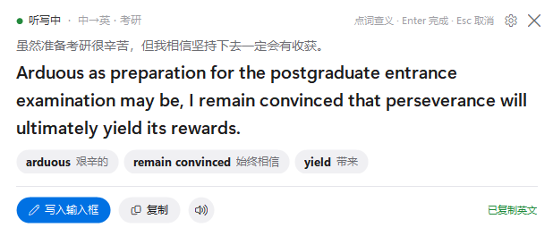
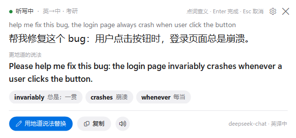
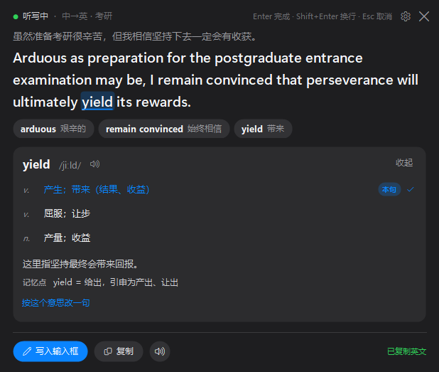
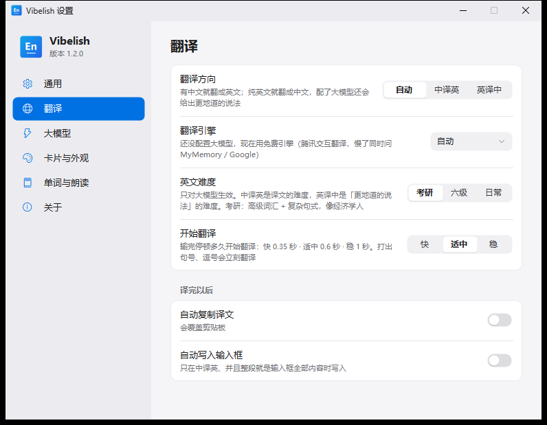

<div align="center">


# Vibelish

**写 prompt 的时候，顺手学英语。**

Windows 托盘小工具：在任意输入框里写中文，旁边的卡片实时给出考研难度的英文；<br>
直接写英文，卡片给出中文意思和更地道的说法。


</div>

<p align="center">
  
  
</p>

## 为什么做它

Vibe coding 的时候，一天里大半时间都在跟 AI 打字对话。反正要打这么多字，不如顺手把英语也练了：

- **写中文**：照常把需求写进 Claude Code、Cursor、终端或者任何输入框，Vibelish 在旁边给出一句考研难度的英文，挑出几个值得记的词。觉得合适，一键换成英文发出去。
- **写英文**：想练英文写作，就直接用英文写 prompt。Vibelish 把你写的英文翻回中文，你一眼就能看出意思对不对；配了大模型，还会给出一句更地道的说法，告诉你哪里可以改。

不用切窗口，不用复制粘贴，不打断手上的活。

## 功能

- **中译英 / 英译中，自动判断**：输入里有中文就翻成英文，纯英文就翻成中文。也可以在托盘菜单或设置里固定一个方向。
- **任意输入框都能用**：VS Code / Cursor、Windows Terminal 和 PowerShell（包括在里面跑的 Claude Code）、浏览器、微信……读不到的输入框还有输入法钩子和 OCR 兜底。
- **快**：大模型逐字输出，第一个词通常一秒内出来；没配大模型时用免费引擎，腾讯交互翻译一般 0.3–0.7 秒。
- **考研 / 六级 / 日常三档难度**：考研档会用更精确的词和复杂句式，读起来像经济学人。
- **重点词**：译文下面列出 3–6 个值得记的词和中文释义，和译文在同一次请求里生成，不用多等。
- **点词查义**：点英文里任意一个单词，看音标、义项、它在这句里的意思和记忆点；还能按另一个义项改写一句。
- **更地道的说法**：英译中时给出改好的英文，可以朗读，也可以一键替换输入框里自己写的那句。
- **朗读**：用 Windows 自带的英文语音，可调语速。
- **好看**：浅色 / 深色跟随系统，六种强调色，卡片不抢焦点，可以拖到任意位置。
- **隐私**：原文和译文不写进日志，API Key 用 Windows DPAPI 加密，密码框自动跳过。

## 安装

到 [Releases](https://github.com/Guiguzic/Vibelish/releases) 下载 `Vibelish-Setup-1.2.0.exe`，双击安装（也可以[从源码构建](#从源码构建)）。

- 装到当前用户目录 `%LOCALAPPDATA%\Programs\Vibelish`，**不需要管理员权限**，也**不需要另外装 .NET**。
- 已经装过会显示「更新」，沿用原来的开机启动和桌面快捷方式选择，设置和 API Key 都保留。
- 静默安装：`Vibelish-Setup-1.2.0.exe --silent`（或 `/S`），失败原因写在 `%TEMP%\Vibelish-Setup.log`。
- 卸载：Windows 设置 → 应用 → Vibelish，或开始菜单里的「卸载 Vibelish」。设置文件 `%APPDATA%\Vibelish` 会保留。

> 从旧版「输入翻译」升级：直接装新版就行。安装程序会清掉旧版的程序、快捷方式和开机启动项，第一次启动时自动把旧设置（包括 API Key）搬过来。

## 快速上手

1. 运行后托盘出现图标。在任意输入框里按 **Ctrl+Alt+T** 开始（被占用时会自动改用 `Ctrl+Alt+E` 等备用组合，实际热键显示在卡片和托盘菜单里）。
2. 照常打字。停顿约 0.6 秒就开始翻译，打出句号、逗号会立刻翻译。
3. 按 **Enter** 完成，**Shift+Enter** 换行，**Esc** 取消。
4. 卡片上的按钮：
   - 中译英：「写入输入框」用英文替换你写的中文，「复制」复制英文。
   - 英译中：「用地道说法替换」把更地道的英文写回输入框，「复制」复制中文意思。
   - 🔊 朗读英文；翻译失败时有「重试」。
5. 点英文里的单词查释义，再点一次或点「收起」关掉。

托盘图标：单击显示 / 隐藏卡片，双击开始 / 结束。右键菜单里有开始翻译、最近翻译（最近 8 条，只在内存里）、翻译方向、设置、启用热键、开机自动启动。

<p align="center">
  
  
</p>

## 两种模式

| | 中译英 | 英译中 |
|---|---|---|
| 你写的 | 中文 | 英文 |
| 卡片上 | 考研 / 六级 / 日常难度的英文 | 中文意思，看看自己写得对不对 |
| 大模型额外给出 | 重点词 | 更地道的说法 + 重点词（比如原句哪里写错了） |
| 写入输入框 | 英文译文 | 更地道的说法 |

「自动」模式按这一段里有没有汉字判断：`帮我 fix 这个 bug` 走中译英，`fix the login bug` 走英译中。少于三个英文字母的（`ok`、`v2`）不翻。开始听写前输入框里已经有的英文（比如终端里的占位提示）不会被翻，改过以后才翻。

## 配置大模型（推荐）

不配也能用：中译英、英译中都会走免费引擎（先问腾讯交互翻译，1.2 秒没回来就同时问 MyMemory 和 Google）。但考研难度、重点词、更地道的说法都需要大模型。

右键托盘图标 → 设置… → 大模型，选服务商，填 API Key 和模型名，点「测试连接」。支持任意 OpenAI 兼容接口，内置这些地址：

| 服务商 | 接口地址 | 建议模型 |
|---|---|---|
| DeepSeek | `https://api.deepseek.com/v1` | `deepseek-chat` |
| 通义千问 | `https://dashscope.aliyuncs.com/compatible-mode/v1` | `qwen-plus` |
| Kimi | `https://api.moonshot.cn/v1` | `moonshot-v1-8k` |
| 智谱 GLM | `https://open.bigmodel.cn/api/paas/v4` | `glm-4-flash` |
| 硅基流动 | `https://api.siliconflow.cn/v1` | `Qwen/Qwen2.5-7B-Instruct` |
| OpenAI | `https://api.openai.com/v1` | `gpt-4o-mini` |
| Ollama（本机） | `http://localhost:11434/v1` | `qwen2.5:7b` |

本机或局域网的服务可以不填 Key。推理模型（如 `deepseek-reasoner`）会先想很久再出字，建议换成 `deepseek-chat` 这类；通义千问、智谱、硅基流动、豆包的「深度思考」会自动关掉。

## 设置

设置窗口改了立刻生效，不用点保存：

- **通用**：全局热键开关、录新热键（Backspace 恢复默认）、开机自动启动。
- **翻译**：翻译方向（自动 / 中译英 / 英译中）、翻译引擎、英文难度、开始翻译的快慢、译完自动复制 / 自动写入。
- **大模型**：服务商、接口地址、API Key、模型、逐字显示、关闭深度思考、测试连接（会显示第一个词和整句各用了多久）。
- **卡片与外观**：主题、强调色、文字大小、卡片位置（跟着输入框 / 屏幕顶部 / 屏幕底部）、显示原文 / 操作提示 / 译文来源、完成后自动收起。
- **单词与朗读**：重点词及显示方式（仅单词 / 带释义 / 详细）、点词查义、朗读按钮、查词时自动朗读、语速。
- **关于**：版本、配置文件夹、运行日志。

<details>
<summary>配置文件 <code>%APPDATA%\Vibelish\config.json</code></summary>

也可以直接改这个文件，改坏了不会丢：启动时会另存为 `config.bad.json` 再用默认值。

| 键 | 说明 |
|---|---|
| `Direction` | `auto`（默认）、`zh2en`、`en2zh` |
| `Engine` | `auto`（默认，配了大模型就用它）、`openai`、`transmart`（腾讯交互翻译）、`mymemory`、`google` |
| `EnglishLevel` | `kaoyan`（默认）、`cet6`、`plain`；只对大模型生效 |
| `OpenAiBaseUrl` / `OpenAiModel` | OpenAI 兼容接口的地址和模型，地址末尾带不带 `/chat/completions` 都行 |
| `OpenAiApiKeyProtected` | 加密后的 API Key（在设置里填；手动填明文 `OpenAiApiKey` 也能读，下次保存时自动加密） |
| `StreamOutput` / `FastThinking` | 逐字显示 / 关闭深度思考（默认都开） |
| `Hotkey` | 例如 `Ctrl+Alt+T`，至少带 Ctrl、Alt 或 Win |
| `PauseMs` | 输完停顿多久开始翻译，200–3000，默认 600 |
| `AutoCopy` / `AutoWrite` | 译完自动复制 / 自动写回输入框（默认关；英译中不会自动写入） |
| `StudyWords` / `StudyStyle` | 显示重点词 / `word`、`meaning`（默认）、`detail` |
| `ClickLookup` | 点英文单词查释义 |
| `ShowSpeak` / `SpeakOnLookup` / `SpeakSpeed` | 朗读按钮 / 查词时自动朗读 / `slow`、`normal`、`fast` |
| `Theme` / `Accent` / `CardTextSize` | `system`、`light`、`dark` / `blue`、`purple`、`pink`、`orange`、`green`、`graphite` / `small`、`normal`、`large` |
| `CardPosition` | `input`（默认）、`top`、`bottom` |
| `ShowSource` / `ShowHints` / `ShowEngine` | 显示原文 / 操作提示 / 译文来源 |
| `AutoHideSeconds` | 完成后几秒自动收起，`0` 表示不收起 |

</details>

## 隐私

- 原文和译文只显示在卡片里，日志 `%APPDATA%\Vibelish\run.log` 只记事件和长度，超过 1 MB 自动轮换。
- 要翻译的文字会发给你选的翻译服务（你配置的大模型接口，或腾讯交互翻译 / MyMemory / Google），不经过别的服务器。
- API Key 用 Windows DPAPI 按当前用户加密，拷走 `config.json` 也解不开。
- 密码框自动跳过；输入里像密钥的字符串（`sk-…`、`ghp_…` 等）在读取时就会被换成 `[•••]`，不会发出去。
- 「开机自动启动」只写当前用户的 `HKCU\Software\Microsoft\Windows\CurrentVersion\Run`。

## 工作原理

- **读输入框**：UI Automation 在后台线程读取焦点输入框；Windows Terminal 和经典控制台按光标所在的那一段输入读取，不把整屏历史当成输入；读不到时由输入法钩子 `native/imehook.cpp`（读取 TSF 输入域）兜底；微信这类自绘输入框用 Windows OCR。
- **一次请求出结果**：译文、重点词（英译中时还有更地道的说法）在同一次请求里返回，用一行 `<<<WORDS>>>` 隔开，流式输出时只显示分隔行之前的部分。
- **提速**：流式输出；按下热键时先预热连接（TLS 握手），之后复用长连接，支持 HTTP/2；能关掉深度思考的服务自动关掉，服务不认这个参数（400 / 422）时自动去掉重发。

## 从源码构建

需要 [.NET 9 SDK](https://dotnet.microsoft.com/download/dotnet/9.0) 和 Visual Studio 生成工具（「使用 C++ 的桌面开发」，x64）。

```powershell
.\build.ps1              # 编译 native\imehook.dll 和主程序
.\build.ps1 -Publish     # 再发布单文件版并生成安装包到 installer\
.\build.ps1 -SkipNative  # 不重新编译输入法钩子
```

没有 C++ 生成工具时，普通编译会跳过输入法钩子（大多数输入框照样能读）；`-Publish` 必须带上钩子。

产物：

- `bin\Release\net9.0-windows10.0.19041.0\Vibelish.exe`：依赖 .NET 9 桌面运行时
- `publish\Vibelish.exe`：单文件自包含，旁边的 `PresentationNative_cor3.dll`、`vcruntime140_cor3.dll` 和 `hook\imehook.dll` 不能删
- `installer\Vibelish-Setup-1.2.0.exe`：安装包，用 Windows 自带的 .NET Framework 4.8 运行

## 诊断

```powershell
Vibelish.exe --translate "fix the login bug"            # 用当前设置翻译一句，打印方向、用时，以及更地道的说法
Vibelish.exe --translate 你好 transmart                  # 临时换引擎
Vibelish.exe --translate 你好 openai http://127.0.0.1:11434/v1 qwen2.5:7b   # 临时换接口和模型，不改配置
Vibelish.exe --diag [--text]                             # 打印当前焦点输入框的信息（加 --text 带正文前 120 字）
Vibelish.exe --selftest-words                            # 卡片排版、翻译方向、流式输出、热键解析等自检
Vibelish.exe --selftest-terminal                         # 终端读取自检
Vibelish.exe --selftest-speech                           # 检查有没有英文语音（不出声）
Vibelish.exe --preview reverse dark+purple shot.png      # 界面预览：card / reverse / reverse-good / gloss / stream / detail / words / listening / error / idle / settings:N
Vibelish.exe --uninstall [--yes]                         # 卸载
```

## License

[MIT](LICENSE) © 2026 Guiguzic

---

<details>
<summary>English</summary>

**Vibelish** is a Windows tray app for learning English while you vibe code. Type Chinese in any input box (your editor, terminal, Claude Code, a chat window) and a floating card shows an exam-level English translation with key words you can click to look up. Type English instead, and the card shows what it means in Chinese plus a more natural way to say it, which you can write back into the input box with one click.

It works with any OpenAI-compatible API (DeepSeek, Qwen, Kimi, GLM, OpenAI, local Ollama) and falls back to free translation engines when no API is configured. The UI is in Chinese.

</details>
